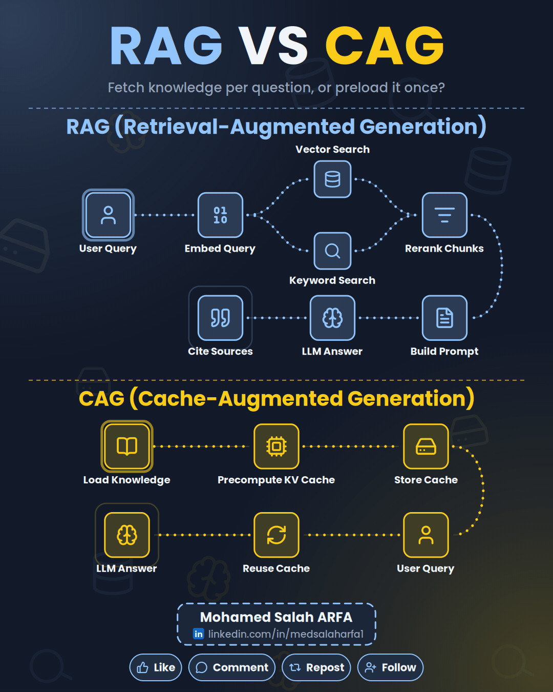
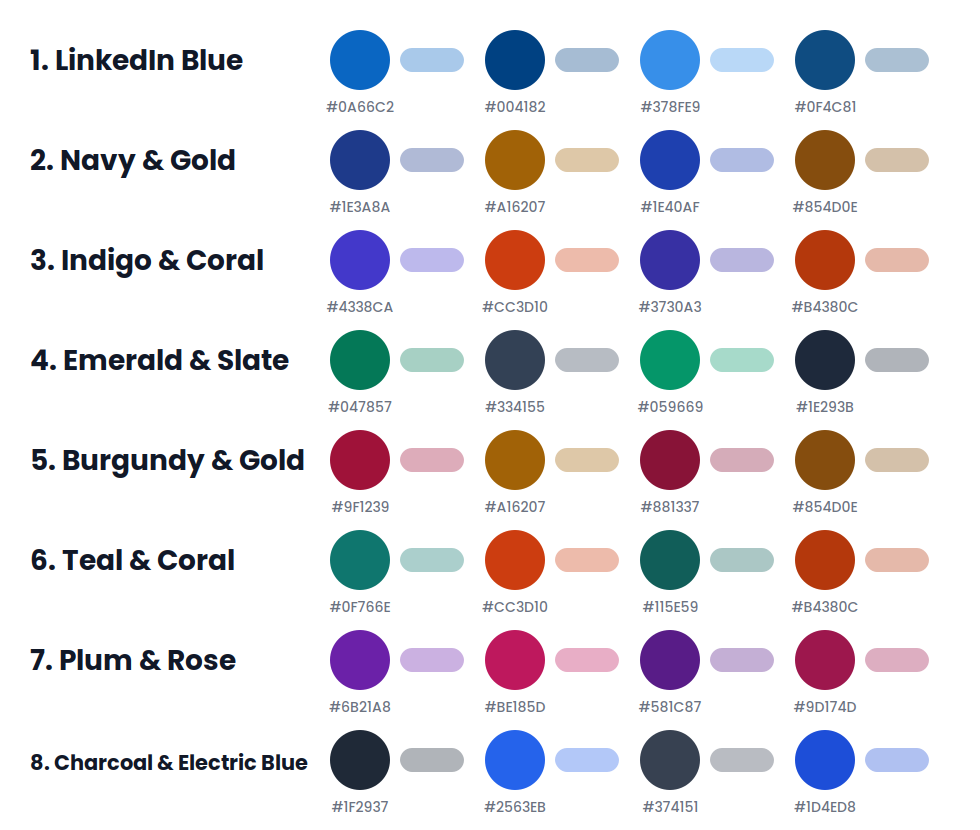
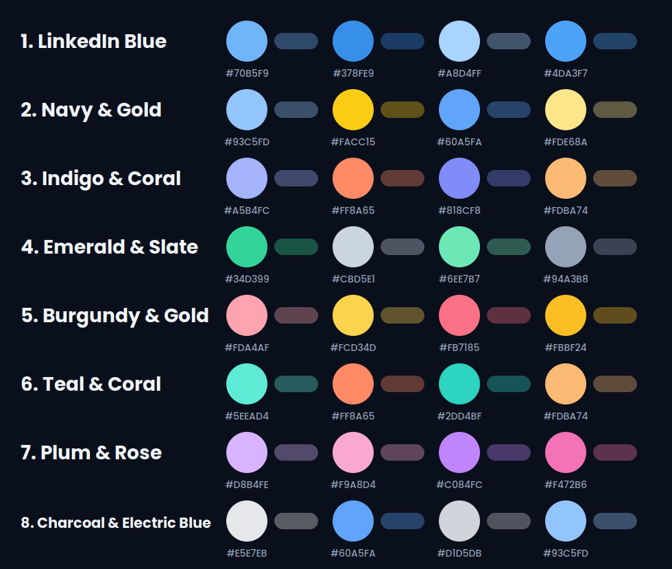

# LinkedIn Animated Diagram

A Claude skill that turns any subject into a **ready-to-post animated LinkedIn GIF**: icon nodes connected by
flowing dotted lines, a pulse that walks through the steps, your name and LinkedIn link in an animated card,
and a Like / Comment / Repost / Follow call to action.

You give Claude a topic. Claude asks a few quick questions, researches the subject, designs the flow,
renders the GIF and writes the caption.

<p align="center">
  
</p>

## Features

- **Topic in, post out.** Say "make an animated LinkedIn diagram about Kubernetes autoscaling" and get a
  1080x1350 looping GIF plus a ready-to-paste caption.
- **Quick personalization.** Name, LinkedIn link, optional profile photo, light or dark background, post
  language and color palette, asked in two short rounds and remembered for the rest of the conversation.
- **21 color palettes, named by color.** 8 premium palettes designed for the LinkedIn feed (LinkedIn Blue,
  Navy & Gold, Indigo & Coral, Emerald & Slate, Burgundy & Gold, Teal & Coral, Plum & Rose, Charcoal &
  Electric Blue) and 13 standard ones, each with a light and a dark variant. Custom hex codes work too,
  with automatic contrast checks.
- **Languages.** English, French and Arabic. Arabic gets properly connected
  letters and a full right-to-left layout.
- **Six visual styles.** `clean`, `tech`, `code`, `editorial`, `bold`, `soft`, all working in both modes.
- **Subject-aware background.** Soft glowing circles in two opposite corners in the palette colors, plus
  very faint icons related to the topic around the edges.
- **Built for the feed.** Seamless loop, smooth gradients, smart compression (typically about 1 MB),
  portrait 4:5 by default.

## Palettes

Premium, light and dark:

<p align="center">
  
  
</p>

Standard palettes: see [`docs/standard-palettes-light.png`](docs/standard-palettes-light.png).

## Install

### Claude.ai or Claude Desktop

1. Download `linkedin-animated-diagram.zip` from the Releases page, or build it yourself with `./build.sh`
   (it is written to `dist/`).
2. Upload the ZIP in the Skills section of Claude's settings. The current steps are in the Help Center
   article [Use skills in Claude](https://support.claude.com/en/articles/12512180-using-skills-in-claude).
3. Code execution must be enabled. The skill's first run downloads fonts, icons and Python packages from
   GitHub, npm and PyPI, so the sandbox needs network access to those sites.

### Claude Code

Copy the skill folder into your personal skills directory:

```bash
git clone https://github.com/MedSalahArfa1/linkedin-animated-diagram.git
cp -r linkedin-animated-diagram/linkedin-animated-diagram ~/.claude/skills/
```

Rendering then runs on your machine, which needs Python 3, Node.js/npm, FFmpeg and Gifsicle. On Windows,
use WSL. The skill writes the GIF to your project folder.

## Usage

Just ask in plain language:

> Make an animated LinkedIn post about RAG vs CAG

> Create a LinkedIn GIF showing how a YOLO model goes from dataset to production

> Fais-moi un visuel animé LinkedIn sur le pipeline MLOps

Claude then:

1. **Intake, round 1:** badge (name, link, photo or not), light or dark background, language.
2. **Intake, round 2:** shows a swatch sheet of 3 palettes that fit the subject (or your own hex codes),
   and asks for your photo if you chose one.
3. **Designs** the flow (one pipeline, an "X vs Y" comparison, or up to three variants), picks a style,
   step icons and background icons.
4. **Previews** a still frame and fixes any layout problems before rendering.
5. **Delivers** the GIF and a caption with a hook, key insight, question and hashtags.

Upload the GIF to LinkedIn as a normal image in your post. Inside a PDF/document carousel it won't animate.

## How it works

Claude writes a small JSON spec; a deterministic renderer does the rest.

```
topic ──> intake ──> content + design (Claude) ──> spec.json ──> render.py ──> preview.png ──> GIF
```

`render.py` lays out the snake-shaped flow, places icons and text, shapes Arabic, draws each frame as SVG,
rasterizes with CairoSVG, and encodes with FFmpeg and Gifsicle, stepping quality down until the file fits
the size budget. Every loop is seamless because all dash animations shift by whole pattern periods.

You can also drive it directly:

```bash
bash linkedin-animated-diagram/scripts/setup.sh                       # once
python3 linkedin-animated-diagram/scripts/render.py --palettes        # list palettes
python3 linkedin-animated-diagram/scripts/render.py --icons fire cloud  # search icons
python3 linkedin-animated-diagram/scripts/render.py examples/rag-vs-cag/spec.json --preview out.png --gif out.gif
```

The spec format is documented in [`linkedin-animated-diagram/references/spec.md`](linkedin-animated-diagram/references/spec.md).

## Repository layout

```
.
├── linkedin-animated-diagram/      # the skill (this folder is what gets installed)
│   ├── SKILL.md                    # instructions Claude follows
│   ├── scripts/
│   │   ├── setup.sh                # installs fonts, icons and dependencies
│   │   └── render.py               # spec -> preview PNG / looping GIF
│   ├── references/spec.md          # spec format
│   └── assets/example-rag-vs-cag.json
├── examples/
│   └── rag-vs-cag/                 # reference post: spec, GIF, preview, caption
├── docs/                           # palette swatch sheets
├── build.sh                        # packages the skill as dist/linkedin-animated-diagram.zip
├── LICENSE
└── THIRD_PARTY_NOTICES.md
```

## Limits

- 1 to 3 sections, up to 12 steps per section, forks of exactly 2 steps.
- Arabic short vowel marks are dropped for clean rendering.

## License

MIT, see [LICENSE](LICENSE). Fonts, icons and libraries are downloaded at runtime under their own licenses,
listed in [THIRD_PARTY_NOTICES.md](THIRD_PARTY_NOTICES.md).

## Author

**Mohamed Salah ARFA**  
[LinkedIn](https://www.linkedin.com/in/medsalaharfa1) · [Website](https://mohamedsalaharfa.com)
