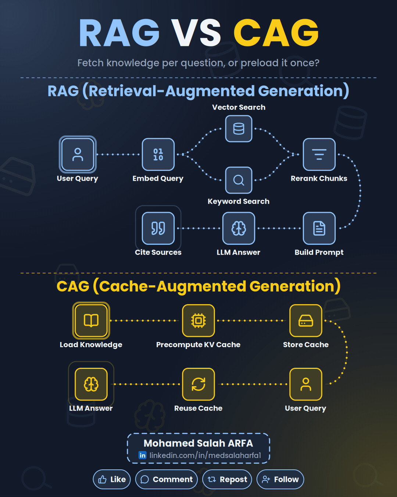

# Example: RAG vs CAG

A two-section comparison post generated with the skill.

| | |
|---|---|
| Palette | Navy & Gold (premium), dark mode |
| Style | `tech` |
| Badge | Name + LinkedIn link, no photo |
| Language | English |
| Output | 1080x1350 looping GIF |



Files:

- `spec.json`: the exact spec the skill wrote for this post
- `rag-vs-cag.gif`: the ready-to-post animation
- `preview.png`: the still frame Claude checks before rendering
- `caption.md`: the LinkedIn caption that came with it

Regenerate it locally (after running `setup.sh` once):

```bash
python3 linkedin-animated-diagram/scripts/render.py examples/rag-vs-cag/spec.json --gif rag-vs-cag.gif
```
